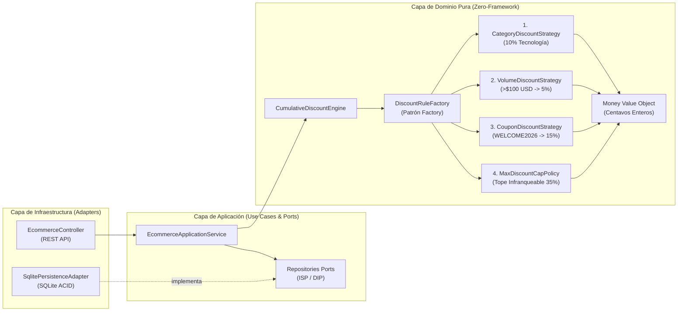

# Defensa y Justificación de Arquitectura: Core E-Commerce con Descuentos Acumulativos

Este documento fundamenta las decisiones de arquitectura, selección de tecnologías, base de datos relacional transaccional (ACID), patrones de diseño e implementación de los principios **S.O.L.I.D.** y **DRY** para el sistema de Checkout con Descuentos Acumulativos en Cascada.

---

## 1. Selección del Stack Tecnológico y Estructura del Monorepo

### 1.1. ¿Por qué Monorepo con `npm workspaces` (`apps/backend`, `apps/frontend`, `packages/shared`)?
En un sistema transaccional de comercio electrónico donde el frontend y el backend intercambian desgloses financieros detallados, el mayor riesgo de defectos es la **deriva de contratos (Contract Drift)**. Al estructurar la solución como un Monorepo con un paquete central `@shopping-cart/shared`:
- **Principio DRY (Don't Repeat Yourself):** Los contratos DTO (`CartQuoteBreakdownDto`, `OrderConfirmationDto`, `DiscountRulesConfigDto`), la constante normativa de la **HU 4** (`MAX_DISCOUNT_CAP_ALERT_MESSAGE`) y las funciones de validación/sanitización (`validateCartRequest`, `sanitizeCouponCode`) se definen **una única vez** en `packages/shared` y son consumidas tanto por NestJS como por Angular.
- **Tipado Estricto de Extremo a Extremo:** Todo el repositorio hereda de `tsconfig.base.json` con `"strict": true` y `"noImplicitAny": true`. Existe **cero uso de `any`** en todo el proyecto.

### 1.2. ¿Por qué Angular 18+ (Signals + Standalone) en el Frontend?
- **Reactividad Determinista con Angular Signals (Patrón Observer):** Un carrito de compras exige recalcular subtotales, cantidades y alertas visuales en tiempo real sin fugas de memoria ni suscripciones manuales complejas. Mediante `signal()` y `computed()` en `CartStoreService`, cualquier cambio en las líneas del carrito o en el desglose del servidor actualiza automáticamente el árbol visual y dispara de forma reactiva el banner del límite del 35% (**HU 4**).
- **Arquitectura Empresarial Escalable:** El uso de inyección de dependencias nativa de Angular permite desacoplar la vista (`CheckoutPageComponent`, `AdminRulesPageComponent`) del estado (`CartStoreService`) y del transporte HTTP (`EcommerceApiService`), facilitando pruebas unitarias deterministas que alcanzan el **96.26% de cobertura**.

### 1.3. ¿Por qué NestJS con Arquitectura Hexagonal en el Backend (Escala E-Commerce tipo MercadoLibre / Amazon)?
En plataformas de e-commerce de alto volumen (como MercadoLibre o Amazon), el motor de promociones (*Pricing & Promotions Engine*) y el procesador de órdenes (*Checkout & Inventory*) son los componentes más críticos del negocio:
1. **Simetría Cognitiva Full Stack (Angular + NestJS):** Comparten el mismo paradigma de ingeniería (Inyección de Dependencias IoC, Módulos, Decoradores, Filtros de Excepción).
2. **Arquitectura Hexagonal (Ports & Adapters):** El contenedor IoC de NestJS permite inyectar **Puertos** (`PRODUCT_REPOSITORY_PORT`, `ORDER_REPOSITORY_PORT`, `RULE_CONFIG_REPOSITORY_PORT`) en la capa de aplicación (`EcommerceApplicationService`), manteniendo la capa `domain/` en **TypeScript 100% puro**, libre de dependencias de HTTP, Express o base de datos.
3. **Preparado para Microservicios:** Gracias al desacoplamiento por módulos y puertos, el motor de descuentos (`CumulativeDiscountEngine`) puede extraerse a un microservicio independiente o ejecutarse en un Worker sin tocar una sola línea de su lógica matemática.

---

## 2. Decisión de Base de Datos: ¿Por qué Relacional (SQLite ACID) y no NoSQL?

### Análisis Comparativo en E-Commerce
En una arquitectura de e-commerce empresarial coexisten dos dominios con requerimientos de almacenamiento opuestos:
- **Catálogo Dinámico, Reseñas y Telemetría:** Ideales para bases de datos **NoSQL** (MongoDB, DynamoDB) por su esquema polimórfico y escalabilidad horizontal de lectura.
- **Checkout Financiero, Control de Inventario y Órdenes (Nuestro MVP):** Exigen estrictamente un **Motor Relacional con Transacciones ACID**.

### Justificación de SQLite Relacional Transaccional en el Proyecto
Elegimos un modelo relacional SQL implementado mediante `SqlitePersistenceAdapter` por cuatro razones técnicas fundamentales:
1. **Atomicidad (Todo o Nada):** Confirmar una orden (**HU 3**) requiere verificar el stock de múltiples productos, descontar las unidades compradas, insertar la cabecera en la tabla `orders` e insertar el detalle en `order_items`. Si el último producto del carrito no tiene stock suficiente, **ningún producto previo puede quedar con el stock descontado**. En `SqlitePersistenceAdapter.createOrderWithStockDeduction()` esto se ejecuta dentro de `BEGIN TRANSACTION ... COMMIT / ROLLBACK`.
2. **Prevención de Sobreventa (Anti-Overselling & Integridad):** La tabla `products` impone la restricción relacional `stock INTEGER NOT NULL CHECK (stock >= 0)` y la sentencia preparada `UPDATE products SET stock = stock - ? WHERE id = ? AND stock >= ?` seguida de la verificación `this.db.getRowsModified() === 1`, impidiendo condiciones de carrera o inventarios negativos.
3. **Seguridad contra SQL Injection:** El 100% de las consultas utilizan sentencias preparadas parametrizadas (`?`).
4. **Portabilidad Cero-Fricción (Patrón Adapter):** Al estar desacoplado detrás de los puertos `ProductRepositoryPort` y `OrderRepositoryPort`, durante los tests corre en memoria en milisegundos, en la demo persiste en disco (`apps/backend/data/ecommerce.sqlite`) sin requerir contenedores Docker externos, y en producción puede reemplazarse por **PostgreSQL** cambiando únicamente el adaptador de infraestructura.

---

## 3. Aislamiento del Motor Matemático y Hallazgo de Ingeniería sobre el Tope del 35%

### 3.1. Aritmética Entera en Centavos (`Money` Value Object)
Operar dinero con `number` en punto flotante IEEE 754 en JavaScript produce errores clásicos (`0.1 + 0.2 === 0.30000000000000004` o sesgos en `toFixed(2)` como `27.325.toFixed(2) === '27.32'`).
- Diseñamos el Value Object inmutable `Money` (`apps/backend/src/domain/value-objects/money.vo.ts`) que almacena y opera exclusivamente en **centavos enteros** (`amountCents`) y aplica redondeo comercial determinista *Half-Up* (`Math.round`) en cada paso de la cascada.

### 3.2. Hallazgo Matemático Crítico y el Panel `/admin` ("Rule Engine Studio")
Al auditar matemáticamente las 3 reglas base del enunciado aplicadas en **cascada multiplicativa** (no sumadas):
- Si un carrito es 100% de categoría `"Tecnología"`, supera los $\$100\text{ USD}$ tras el primer descuento y aplica `"WELCOME2026"`, la fracción pagada es:
  $$0.90 \times 0.95 \times 0.85 = 0.72675 \implies \text{Descuento máximo posible} = 1 - 0.72675 = \mathbf{27.325\% \approx 27.33\%}$$
- Como $27.33\% < 35\%$, con porcentajes estáticos quemados en código (`hardcoded`) **sería matemáticamente imposible activar en vivo la HU 4 (alerta del 35%) durante la demostración**.
- **Solución de Ingeniería:** Parametrizamos las reglas en base de datos y construimos el módulo **`/admin` (Rule Engine Studio)** en Angular conectado a `/api/admin/rules`, además de incluir el cupón promocional `VIP50` (30%) y el preset de 1 clic **"Preset Demo Tope >35%"** para demostrar en vivo cómo el motor trunca exactamente en el **35%** y dispara la alerta de la **HU 4**, conservando intacto el preset **"Reglas Oficiales Kata"**.

---

## 4. Patrones de Diseño y Principios S.O.L.I.D. Implementados

| Patrón / Principio | Ubicación en el Código | Justificación Técnica |
| :--- | :--- | :--- |
| **1. Patrón Strategy** | `domain/discounts/strategies/*` (`DiscountStrategy`, `CategoryDiscountStrategy`, `VolumeDiscountStrategy`, `CouponDiscountStrategy`) | Encapsula cada algoritmo de descuento en su propia clase aislada, cumpliendo **Single Responsibility (SRP)** y **Liskov Substitution (LSP)**. |
| **2. Patrón Factory** | `domain/discounts/discount-rule.factory.ts` (`DiscountRuleFactory`) | Centraliza la creación del pipeline de estrategias y garantiza su orden estricto de precedencia (`1. Categoría -> 2. Volumen -> 3. Cupón`) más `MaxDiscountCapPolicy`, cumpliendo **Open/Closed (OCP)**. |
| **3. Patrón Adapter / Repository** | `application/ports/repositories.ports.ts` y `infrastructure/persistence/sqlite-persistence.adapter.ts` | Aísla la persistencia SQLite detrás de interfaces segregadas (**ISP** y **DIP**). |
| **4. Patrón Observer Reactivo** | `apps/frontend/src/app/state/cart-store.service.ts` (`CartStoreService`) | Utiliza Angular Signals (`signal`, `computed`) para notificar reactivamente a los componentes de la UI ante cambios en el carrito, cotización o activación del tope del 35%. |
| **5. Value Object & Policy (DDD)** | `domain/value-objects/money.vo.ts` y `domain/discounts/max-discount-cap.policy.ts` | Protege las invariantes financieras (no negatividad, centavos enteros y truncado infranqueable al 35%). |

---

## 5. Seguridad Aplicada (AppSec / Estándares FinTech)

1. **Protección Anti-Price Tampering (OWASP API3:2023):** Los endpoints `/api/cart/quote` y `/api/checkout` **jamás** reciben precios ni porcentajes desde el cliente; `validateCartRequest` aplica una lista blanca estricta que rechaza cualquier propiedad distinta a `productId`, `quantity` y `couponCode`. El backend consulta siempre el precio autoritativo en SQLite.
2. **Validación de Rangos y Sanitización:** Se bloquean carritos vacíos, cantidades $\le 0$, decimales, `NaN`, `Infinity` o cantidades consolidadas $> 999$. Los códigos de cupón se sanitizan y validan con expresión regular alfanumérica (`/^[A-Z0-9_-]{3,25}$/`).
3. **Hardening HTTP:** Uso de `helmet()`, política CORS explícita y `DomainExceptionFilter` para evitar fuga de trazas internas (*stack traces*).

---

## 6. Trade-offs Asumidos

- **SQLite embebido (`sql.js` WebAssembly) vs. Servidor PostgreSQL externo:** Se priorizó que la mesa evaluadora pueda clonar el repositorio y ejecutar `npm install`, `npm run test:coverage` y levantar la aplicación en segundos sin depender de instalaciones nativas de C++ (`node-gyp`) ni contenedores Docker externos, manteniendo transacciones SQL ACID reales y persistencia en archivo.
- **Cotización en Servidor (`POST /api/cart/quote`) vs. Cálculo Duplicado en Frontend:** Se decidió que el frontend calcule inmediatamente el subtotal original local (**HU 1**) y consulte al backend para el desglose en cascada (**HU 2 y HU 4**). Aunque implica una llamada HTTP ligera en local, garantiza una **única fuente de verdad matemática (DRY)** y evita discrepancias entre lo que ve el usuario y lo que cobra el checkout.
